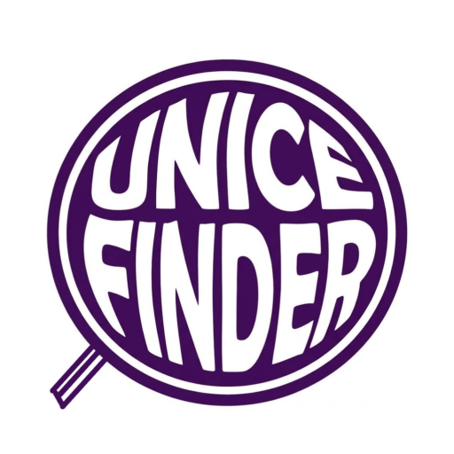

# 🔎 UNICEFINDER

  

  ### Sistema de Achados e Perdidos da UNICEPLAC

  **Conectando pessoas aos seus pertences.**

  Uma solução digital para modernizar e simplificar o sistema de achados e perdidos no ambiente acadêmico.

  **Projeto Acadêmico | UNICEPLAC**

---

## 📖 Sobre o Projeto

O **UNICEFINDER** é uma ferramenta desenvolvida para digitalizar e facilitar o processo de achados e perdidos na comunidade acadêmica da **UNICEPLAC**.

O projeto busca oferecer um ambiente centralizado, acessível e intuitivo, permitindo que estudantes e colaboradores encontrem informações sobre objetos perdidos ou encontrados dentro da instituição.

## 📝 Justificativa

O processo tradicional de achados e perdidos pode apresentar dificuldades, como a falta de organização, a divulgação limitada e a dificuldade de localizar informações.

Pensando nisso, o **UNICEFINDER** propõe uma alternativa digital que centraliza essas informações, tornando a busca por objetos mais prática, organizada e eficiente.

A iniciativa busca contribuir para a comunicação entre os membros da comunidade acadêmica e facilitar a recuperação de pertences.

## 🎯 Objetivos

- **Digitalização:** modernizar o processo de achados e perdidos.
- **Centralização:** reunir informações em um único ambiente.
- **Acessibilidade:** facilitar a consulta de objetos perdidos e encontrados.
- **Organização:** proporcionar uma experiência simples e intuitiva.
- **Comunicação:** aproximar estudantes e colaboradores na recuperação de pertences.

## 👥 Integrantes da Equipe

| Integrante | Função | GitHub |
|:---|:---|:---|
| **Carlos Eduardo Santos Silva** | Gerente de Projeto | [@kontz-z](https://github.com/kontz-z) |
| **Fillipi Gabriel Bezerra de Lima** | Designer UI/UX | — |
| **José Eduardo de Almeida Araújo** | Desenvolvedor | — |
| **Marcelo Henrique Vieira de Sousa** | Analista de Requisitos | [@codebysousa](https://github.com/codebysousa) |
| **Yan Victor Araújo Freire** | Desenvolvedor | [@osepty](https://github.com/osepty) |

## 🎥 Vídeo Pitch

Conheça a proposta do UNICEFINDER através do nosso vídeo de apresentação.

  

  **[▶️ Assistir ao Vídeo Pitch](https://www.youtube.com/watch?v=pKPyqQ6gLaw)**

---

  Desenvolvido como projeto acadêmico por estudantes da UNICEPLAC.

